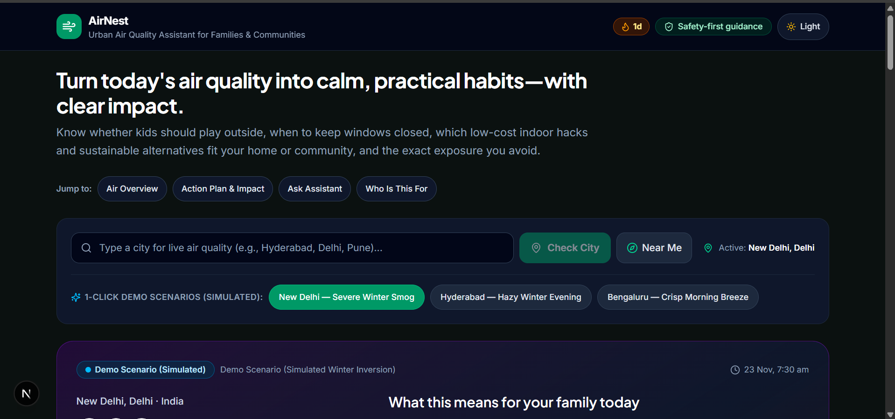
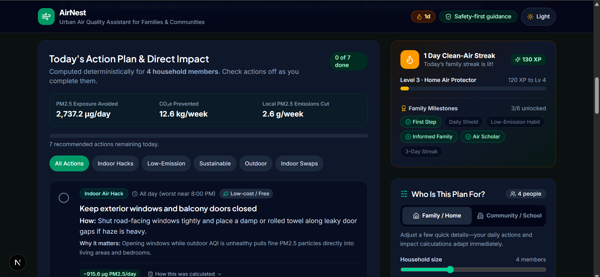
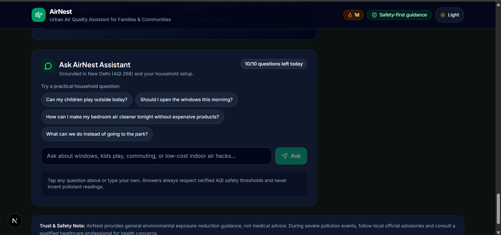
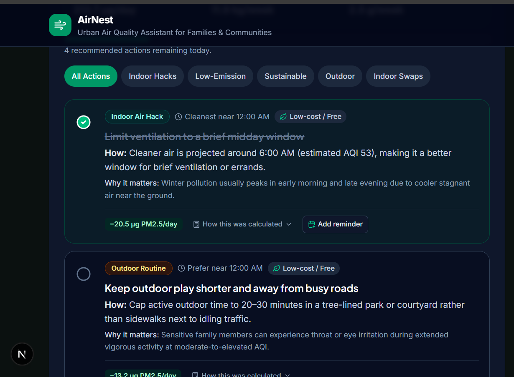
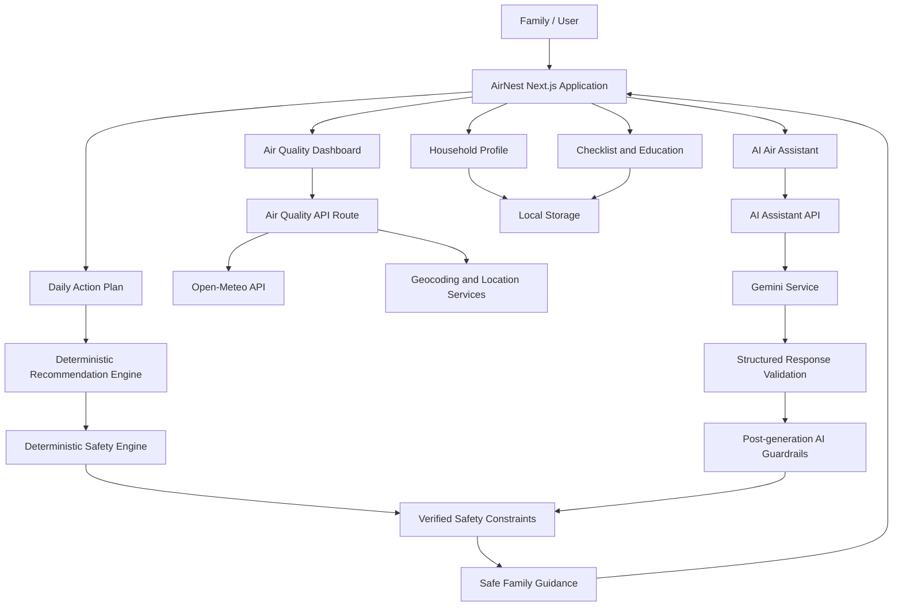
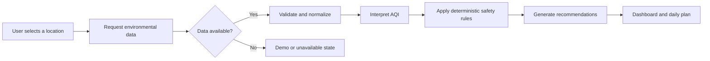
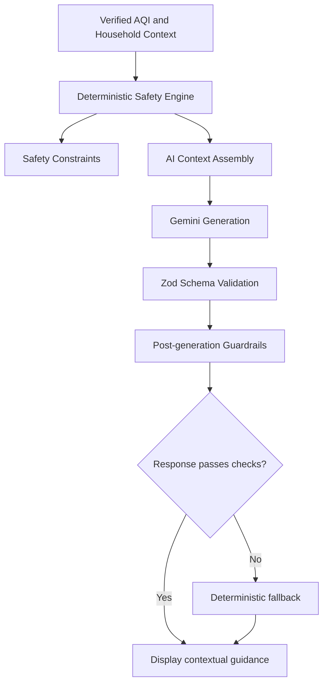

# AirNest — Urban Air Quality Assistant for Families

> **PromptWars Virtual Challenge · Challenge 06**  
> *Don't just tell families how polluted the air is. Tell them what they can realistically do about it today.*

<p align="center">
  
  
  
  
  
</p>

<p align="center">
  
  
  
  
  
</p>

---

## 🌿 Overview

Winter air pollution affects how families commute, exercise, ventilate their homes and plan outdoor activities. Many air-quality dashboards display AQI values and pollutant charts but leave people unsure about what to do next.

**AirNest turns environmental information into practical, household-level decisions.** It combines air-quality data, deterministic safety rules and family preferences to help users plan ventilation, indoor activities, commuting and everyday routines.

AirNest is designed to help families answer questions such as:

- Is it a suitable time for children or older adults to spend time outdoors?
- Should we open our windows right now?
- What practical steps can reduce indoor pollution?
- What can we do indoors when outdoor conditions are unfavorable?
- How can we adapt today's commute or routine?

### Guiding principle

> **Don't just tell families how polluted the air is. Tell them what they can realistically do about it today.**

---

## ✨ Features

| Feature | What it does |
| --- | --- |
| 🌍 **Air-quality dashboard** | Presents AQI, pollutant concentrations, categories, hourly information and reading timestamps. |
| 🔎 **Data provenance** | Distinguishes live data, delayed readings, demo scenarios and unavailable data. |
| 🏙️ **City and location explorer** | Supports city search, location selection and the available location lookup flow. |
| 👨‍👩‍👧 **Household personalization** | Uses household and family context, sensitivities, purifier ownership, commute mode and preferences. |
| 📅 **Daily action plan** | Generates practical recommendations for different parts of the day. |
| 🪟 **Ventilation guidance** | Uses air-quality context to guide window opening and ventilation decisions. |
| 🏠 **Indoor-air suggestions** | Offers practical ways to reduce indoor smoke, dust and combustion-related pollution. |
| 🚶 **Low-emission routines** | Suggests cleaner travel choices without encouraging outdoor activity during unsafe conditions. |
| ☑️ **Action checklist** | Lets users track recommendations and retain checklist state locally. |
| 🤖 **AI air assistant** | Answers household questions using validated environmental and household context, with deterministic safety guardrails. |
| 🧒 **Indoor activity alternatives** | Suggests alternatives when outdoor conditions are unfavorable. |
| 📚 **Pollution education** | Explains AQI, PM2.5, PM10, winter inversions and indoor/outdoor pollution. |
| 🌗 **Light and dark themes** | Provides theme-aware layouts and AQI visualizations. |
| 📱 **Responsive interface** | Adapts the dashboard for mobile, tablet and desktop screens. |

---

## 🚀 Current Implementation — Four Completed Batches

The current deployed build incorporates the following four implementation batches.

### 1. Foundation and safety engine

- Added TypeScript domain types and Zod schemas for structured data validation.
- Implemented deterministic AQI thresholds and safety-critical baseline decisions.
- Added automated unit tests for core domain and safety logic.
- Kept safety-critical interpretation independent of generative AI.

### 2. Live data and planning engine

- Integrated the environmental data client and location-aware data flow.
- Implemented a deterministic daily recommendation engine.
- Added the rate-limited `GET /api/air-quality` route.
- Kept demo and unavailable-data states distinguishable from live readings.

### 3. AI layer and hardened guardrails

- Added server-side `POST /api/plan` and `POST /api/assistant` routes.
- Used structured JSON responses with Zod validation.
- Added server-side Gemini API-key rotation and automatic failover.
- Applied deterministic post-generation guardrails so AI output cannot override verified AQI, ventilation or health-safety constraints.
- Retained deterministic fallback guidance when the AI path is unavailable or returns unusable output.

### 4. Core experience and personalization

- Delivered the interactive AirNest dashboard with location and demo-scenario switching.
- Added household/family profile personalization.
- Added interactive daily action checklists.
- Connected environmental context, household preferences and recommendations in the main user experience.

---

## 📚 Project Documentation

| Document | Description |
|---|---|
| [Problem Alignment](PROBLEM_ALIGNMENT.md) | Problem statement, target users, and how AirNest addresses the challenge requirements. |
| [Testing Guide](TESTING.md) | Test strategy, validation commands, coverage areas, and quality checks. |
| [Security Policy](SECURITY.md) | Security practices, vulnerability reporting, and application safeguards. |
| [Accessibility](ACCESSIBILITY.md) | Accessibility principles, inclusive design, and usability considerations. |

---

## 📸 Product Experience
| Air-quality dashboard | Personalized action plan |
| --- | --- |
|  |  |

| AI air assistant | Household checklist |
| --- | --- |
|  |  |

---

## 🏗️ System Architecture

AirNest separates environmental data, deterministic safety logic, AI orchestration, application services and UI components. This separation keeps safety-critical decisions predictable while allowing AI to personalize explanations and recommendations.



### Architectural principles

- **Domain-first design:** AQI interpretation and recommendation rules stay separate from UI rendering.
- **Separation of concerns:** Data clients, API routes, AI services, safety rules, persistence and presentation have distinct responsibilities.
- **Server-side secrets:** Provider keys are handled on the server and must not be exposed through `NEXT_PUBLIC_` variables.
- **Validated boundaries:** External data, user input and AI responses are validated before use.
- **Graceful degradation:** Core guidance remains available through deterministic logic when generative AI is unavailable.
- **Minimal infrastructure:** The application does not require a user account system or a mandatory external database for its core experience.

---

## 🧩 Project Structure

The following is a high-level view of the current application structure. Individual files may evolve as the project is refactored.

```text
src/
├── domain/
│   └── air-quality/
│       ├── types.ts
│       ├── schemas.ts
│       ├── thresholds.ts
│       ├── recommendations.ts
│       ├── ai-guardrails.ts
│       ├── demo-scenarios.ts
│       ├── education.ts
│       └── __tests__/
├── services/
│   ├── open-meteo.ts
│   └── ai-assistant.ts
├── lib/
│   ├── rate-limit.ts
│   ├── aqi-theme.ts
│   └── storage.ts
├── app/
│   ├── api/
│   │   ├── air-quality/
│   │   ├── plan/
│   │   └── assistant/
│   ├── globals.css
│   ├── layout.tsx
│   └── page.tsx
└── components/
    └── Modular UI components
```

---

## 🌫️ Air-quality and Environmental Data

### Data pipeline



### Supported information

- US AQI
- PM2.5 and PM10
- Nitrogen dioxide (NO₂)
- Ozone (O₃)
- Hourly environmental information where provided by the data source
- Selected location and reading timestamp
- AQI category and practical interpretation

### Data transparency

AirNest distinguishes the source and availability of readings instead of presenting every value as live data.

| State | Meaning |
| --- | --- |
| 🟢 **Live data** | Environmental data was successfully retrieved from the configured source. |
| 🟡 **Delayed reading** | Data is available but may not represent current conditions. |
| 🔵 **Demo scenario** | Simulated conditions are being used for demonstration. |
| ⚪ **Unavailable** | A reliable reading is not currently available. |

**Simulated demo values must not be interpreted as live measurements.**

---

## 🧠 Safety-first AI Architecture

AirNest combines a **deterministic safety engine** with **bounded generative AI**. AI helps personalize language and household guidance; it does not establish the application's safety-critical AQI thresholds.

### Deterministic safety engine

The domain layer establishes validated AQI categories and safety constraints for areas such as:

- Ventilation guidance.
- Outdoor activity recommendations.
- Child and sensitive-household considerations.
- Activity timing when supported by available environmental data.
- Lower-emission mobility alternatives.
- Severe-pollution advisories.

### Context-grounded AI

The AI routes receive relevant validated context, including the available environmental snapshot, data provenance, household preferences and deterministic safety instructions.

### Validation and post-generation checks

1. The application prepares validated AQI and household context.
2. The deterministic engine establishes applicable safety constraints.
3. Gemini generates a structured response for the relevant workflow.
4. Zod validates the generated response.
5. Post-generation guardrails check the response against deterministic constraints.
6. Unsafe or invalid output is rejected or replaced with deterministic fallback guidance.



> **AI may personalize the guidance. It must never override verified environmental data or deterministic safety rules.**

AirNest is an environmental-awareness and lifestyle-guidance tool, not a medical diagnostic service.

---

## 🤖 Generative AI Integration

AirNest uses the **Google Gemini API** through the official `@google/genai` SDK. Gemini calls are made through server-side Next.js route handlers so provider credentials are not exposed to browser code.

| Item | Implementation |
| --- | --- |
| Provider | Google Gemini API |
| SDK | `@google/genai` |
| Primary model | `gemini-3.8-flash` |
| Fallback model | `gemini-2.5-flash` |
| Execution | Server-side Next.js route handlers |
| Response format | Structured JSON validated with Zod |
| Resilience | Server-side API-key rotation and automatic failover, with deterministic fallback guidance |
| Credential | Server-side Gemini API key configuration |

Model identifiers and availability can change. Refer to the [official Gemini API model documentation](https://ai.google.dev/gemini-api/docs/models) when changing model configuration.

### AI-powered workflows

#### Personalized daily plan

**Endpoint:** `POST /api/plan`

Uses Gemini to personalize the daily plan using the household context and validated AQI constraints. Deterministic recommendation logic remains responsible for the underlying safety rules.

#### Grounded conversational assistant

**Endpoint:** `POST /api/assistant`

Uses the available environmental snapshot, location context, household preferences and safety instructions to answer practical questions such as:

- Is it a suitable time for my children to play outside?
- When should we ventilate our home?
- How can we make our indoor air cleaner tonight?
- What can we do instead of going to the park?
- How can we adapt our commute during poor air quality?

### Graceful fallback

When Gemini is unavailable, rate-limited, unconfigured or returns invalid output:

- Core dashboard functionality remains available.
- Deterministic safety guidance remains independent of AI availability.
- The application can use fallback recommendations instead of relying on an unverified AI response.
- AI availability should be communicated honestly to the user.

---

## 🛡️ Security and Reliability

| Area | Current approach |
| --- | --- |
| Type safety | Strict TypeScript domain types |
| Input and output validation | Zod schemas at application boundaries |
| AI response safety | Structured response validation and deterministic post-generation guardrails |
| API credentials | Server-side environment configuration; never use the `NEXT_PUBLIC_` prefix for secrets |
| Gemini resilience | Server-side key rotation and automatic failover |
| Request protection | Rate limiting on the air-quality API route |
| External environmental data | Validation and normalization before downstream use |
| Failure handling | Deterministic guidance and explicit unavailable/error states |
| Client persistence | Local storage helpers for household preferences and checklist state |

**Verified Security Hardening:**
- **Production Response Headers (`next.config.ts`):** Enforces strict Content-Security-Policy (without `'unsafe-eval'` in production and without browser-side Gemini egress), `Strict-Transport-Security`, `X-Content-Type-Options: nosniff`, `X-Frame-Options: DENY`, `Cross-Origin-Opener-Policy: same-origin`, `Referrer-Policy`, `Permissions-Policy`, and `poweredByHeader: false`.

- **Request Boundary Protection (`src/lib/http.ts`):** Enforces `Content-Type: application/json` (`415`) and a strict 16 KB declared + actual UTF-8 byte cap (`413`) before JSON parsing or Zod schema validation—directly mitigating oversized-payload memory-exhaustion vectors in `zod` (`npm audit` notes only major-version upgrades for build-time `postcss` and `zod@4`).

- **Static & Lint Gates (`eslint.config.mjs`):** Enforces zero warnings (`--max-warnings=0`), strict equality (`eqeqeq`), and blocks `eval`/`implied-eval`/`new Function`.

---

## ♿ Accessibility and Responsive Design

AirNest is designed to support different screen sizes and interaction needs. The interface should be reviewed for:

- Semantic page landmarks and clearly labelled navigation.
- Keyboard-accessible links, controls and forms.
- Visible focus states and appropriately sized touch targets.
- Readable contrast in light and dark themes.
- AQI communication that does not rely on color alone.
- Clear loading, empty, error and completion states.
- Reduced-motion preferences where applicable.

**Verified Accessibility Checks (`src/domain/__tests__/accessibility-and-components.test.tsx`):**
- Automated `axe-core` WCAG 2.0 / 2.1 / 2.2 Level A & AA audits pass with **0 violations** across 6 core interactive views (`AqiOverviewCard`, `DailyActionChecklist`, `FamilyProfilePanel`, `LocationSwitcher`, `AirQualityAssistant`, and `PollutionEducation`).

- Mathematical WCAG 1.4.3 (`>= 4.5:1`) luminance contrast verification passes across all Light and Dark theme pairs.

- Dynamic AQI changes and AI assistant responses announce updates via polite `aria-live` regions, paired with non-color category symbols and keyboard-navigable combobox/disclosure controls.

---

## 🧰 Technology Stack

| Technology / Service | Purpose |
| --- | --- |
| Next.js 15 | Full-stack framework and App Router |
| React 19 | Component-based user interface |
| TypeScript | Type safety and maintainability |
| Tailwind CSS v4 | Styling and responsive layouts |
| Lucide React | Interface icons |
| Zod | Runtime schema validation |
| Open-Meteo Air Quality API | Environmental data |
| Open-Meteo Geocoding API | City search and coordinates |
| BigDataCloud | Reverse geocoding, where used by the location flow |
| Google Gemini API | AI-powered plan personalization and conversational guidance |
| `@google/genai` | Official Gemini SDK |
| `localStorage` | Household profile and checklist persistence |
| Vitest | Unit and service testing |

---

## 🚀 Getting Started

### Prerequisites

- Node.js version supported by the project's Next.js 15 dependencies.
- npm.
- Git.

### 1. Clone the repository

```bash
git clone https://github.com/bhargavaalapati/H2SPWC6Urban-Air-Quality-Assistant-problem.git
cd H2SPWC6Urban-Air-Quality-Assistant-problem
```

### 2. Install dependencies

```bash
npm install
```

### 3. Configure environment variables

Create a local environment file from the example file:

```bash
cp .env.example .env.local
```

On Windows PowerShell, use:

```powershell
Copy-Item .env.example .env.local
```

Configure the Gemini variables used by the application:

```env
GEMINI_API_KEY=your_server_side_gemini_api_key
GEMINI_MODEL=gemini-3.8-flash
```

The application also uses `gemini-2.5-flash` as its fallback model in the current configuration. Keep all provider keys on the server; never commit real keys or expose them through `NEXT_PUBLIC_` variables. Check `.env.example` and the current implementation for the exact key-rotation configuration used by the project.

Gemini configuration is optional for the deterministic portions of the application. Without a configured AI provider, AI-powered responses may fall back or be unavailable while core air-quality and safety functionality remains available.

### 4. Start the development server

```bash
npm run dev
```

Open [http://localhost:3000](http://localhost:3000).

---

## ⚙️ Environment Variables

| Variable | Required | Description |
| --- | --- | --- |
| `GEMINI_API_KEY` | Optional for core deterministic features | Server-side Google Gemini API credential. |
| `GEMINI_MODEL` | Optional | Overrides the configured primary Gemini model. |

The project may use additional server-side configuration for key rotation. Refer to `.env.example` and the implementation for the authoritative variable names. **Never commit secrets.**

---

## 🧪 Validation and Testing

Run the checks configured in the repository before creating a submission commit:

```bash
# TypeScript validation
npm run typecheck

# Unit, service, domain and guardrail tests
npm run test

# Lint
npm run lint

# Production build
npm run build
```

### Existing test focus

- AQI thresholds and classification.
- Deterministic recommendation generation.
- Ventilation and outdoor-activity safety guardrails.
- Household personalization logic.
- AI response validation and fallback behavior.
- Environmental data service behavior.
- API input validation and failure handling.
- Checklist and storage utilities.

### Verified Quality Gate Results (`npm run check && npm run build`)

- **TypeScript (`tsc --noEmit`):** 0 errors (strict mode + `noUncheckedIndexedAccess`).
- **ESLint (`eslint . --max-warnings=0`):** 0 errors, 0 warnings.
- **Vitest (`vitest run --coverage`):** **13 test files, 88 passing tests** (enforced thresholds: 90% lines/statements/functions, 82% branches).
  - **Statements / Lines:** `96.98%`
  - **Functions:** `98.00%`
  - **Branches:** `86.71%`
- **Production Build (`next build`):** Compiled cleanly (`/` First Load JS: `151 kB`).

---

## 🎬 Demo Scenarios and Judge Walkthrough

AirNest includes predefined winter scenarios so the experience can be demonstrated without depending entirely on live API availability.

| Scenario | Description |
| --- | --- |
| 🇮🇳 New Delhi | Severe winter smog |
| 🇮🇳 Hyderabad | Hazy winter evening |
| 🇮🇳 Bengaluru | Crisp morning breeze |

### Suggested walkthrough

1. Open AirNest using the default demo scenario.
2. Review the AQI, pollutant readings and data-provenance state.
3. Switch between available location or demo scenarios.
4. Add household preferences and family context.
5. Review the personalized daily action plan.
6. Ask the AI assistant a practical household question.
7. Interact with the daily action checklist.
8. Review the responsive layout and theme options.

---

## 🗺️ Development Roadmap

### Current deployed build

- [x] TypeScript domain foundation and Zod schemas.
- [x] Deterministic AQI thresholds and baseline safety rules.
- [x] Live environmental data integration and rate-limited air-quality route.
- [x] Deterministic daily recommendation engine.
- [x] Gemini-powered plan and assistant routes.
- [x] Structured AI response validation and deterministic post-generation guardrails.
- [x] Server-side Gemini key rotation and automatic failover.
- [x] Location/demo switching and household personalization.
- [x] Interactive daily action checklist.
- [x] **Household and community modes:** Add a Household / Community (school or RWA) context switch, with relevant group-size and local pollution-source inputs.
- [x] **Deterministic impact engine:** Calculate per-action and aggregate impact estimates for PM2.5 exposure avoided, CO₂e saved and PM2.5 emissions prevented. Label every calculation factor as a published factor or transparent assumption, and show the calculation method to users.
- [x] **AI number firewall:** Restrict generated numerical claims to the active AQI snapshot, verified impact calculations or numbers supplied by the user.
- [x] **Calendar reminders:** Add a zero-dependency Google Calendar link for recommendations with a supported time window.
- [x] **Dashboard refactor:** Extract data and household-state hooks, and divide recommendation strategies and Gemini client/prompt responsibilities into focused modules.
- [x] **Quality gates:** Add formatting and stricter lint rules, a health-check endpoint and a GitHub Actions workflow for typecheck, lint, tests and build.
- [x] **Expanded testing:** Add coverage reporting and targeted tests for impact calculations, number validation, strategy selection, API health and UI interactions.
- [x] **Accessibility verification:** Add DOM and accessibility tests for keyboard navigation, screen-reader announcements, non-color-only AQI status and light/dark states.
- [x] **Security hardening:** Verify security headers, request content types and body-size limits, then review dependency audit results.
- [x] **Traceable documentation:** Add focused problem-alignment, security, testing and accessibility documents that map requirements to implementation and tests.


### Later possibilities

- [ ] Tool-assisted environmental queries and clean-air timing discovery.
- [ ] Indoor-activity recommendations exposed through callable tools.
- [ ] Multi-city comparison based on verified data.
- [ ] Optional MCP integration only where it adds measurable user value.
- [ ] Final performance, accessibility, security and submission audit.

### Scope principles

- Keep the core experience usable without mandatory authentication.
- Avoid introducing a heavyweight database or unnecessary backend services.
- Keep AI optional and out of safety-critical threshold decisions.
- Prefer transparent, testable calculations over unsupported impact claims.
- Keep the repository and deployment lean; validate actual repository size and branch count before submission.

---

## 🎯 Challenge Alignment

| Evaluation area | AirNest approach |
| --- | --- |
| **Problem alignment** | Converts air-quality information into practical family decisions. |
| **Code quality** | Domain logic, strict typing, validation and separated application responsibilities. |
| **Security** | Server-side secrets, validated inputs/outputs, rate limiting and AI guardrails. |
| **Efficiency** | Lightweight application architecture, data handling and minimal mandatory infrastructure. |
| **Testing** | Unit tests for domain logic, services, guardrails and API behavior. |
| **Accessibility** | Semantic landmarks, keyboard combobox/disclosures, `aria-live` announcements, non-color AQI symbols, and verified WCAG 2.2 AA (`axe-core` + 4.5:1 contrast tests). |
| **AI value** | Grounded plan personalization and contextual conversational assistance. |
| **Practical usability** | Demo scenarios, household preferences and an interactive action checklist. |

---

## ⚠️ Health and Environmental Disclaimer

AirNest provides environmental awareness and general lifestyle guidance. It does not diagnose, prevent or treat medical conditions. Environmental readings may be delayed, unavailable or different from conditions at a user's exact location. During severe pollution episodes, follow local official advisories and consult qualified healthcare professionals for medical concerns.

---

## 📚 References

- [Google Gemini API documentation](https://ai.google.dev/gemini-api/docs)
- [Google Gemini API model documentation](https://ai.google.dev/gemini-api/docs/models)
- [Open-Meteo Air Quality API](https://open-meteo.com/en/docs/air-quality-api)
- [Open-Meteo Geocoding API](https://open-meteo.com/en/docs/geocoding-api)

---

## 🌱 Vision

**Environmental data becomes valuable when people can use it to make better everyday decisions.**

By combining reliable environmental information, deterministic safety logic, household context and responsible AI, AirNest aims to make clean-air decisions simpler, more practical and more accessible for urban families.

<p align="center"><strong>Built for families. Grounded in data. Guided by safety.</strong></p>
<p align="center"><em>AirNest · PromptWars Virtual Challenge 06</em></p>
