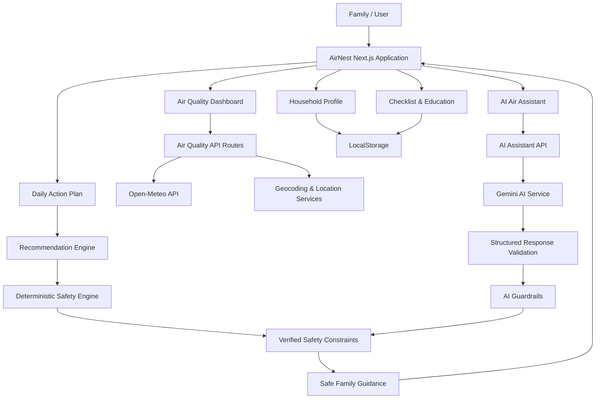
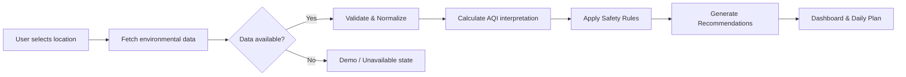
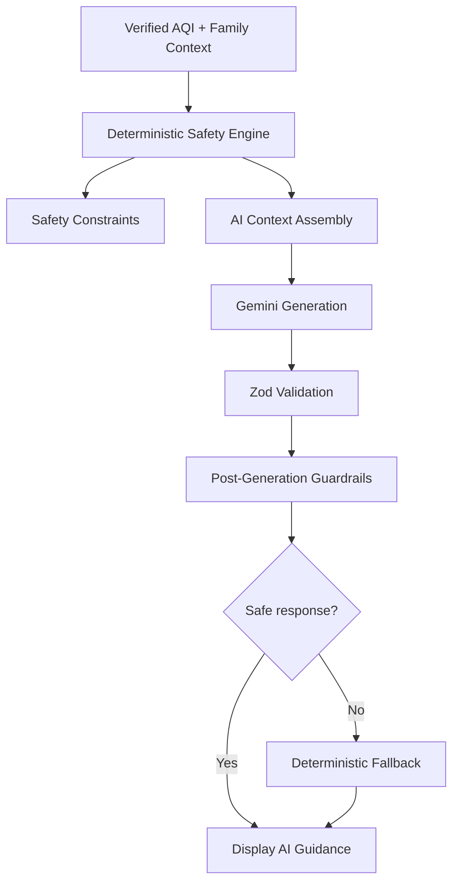

# AirNest — Urban Air Quality Assistant for Families

> **PromptWars Virtual Challenge · Challenge 06**
>
> *Don't just tell families how polluted the air is. Tell them what they can realistically do about it today.*


 <p align="center">
  
  
  
  
  
</p>

<p align="center">
  
  
  
</p>

---

## 🌿 Overview

Winter pollution affects how families commute, exercise, ventilate their homes, and plan outdoor activities. Conventional air-quality dashboards often present AQI numbers and pollutant charts without explaining what households should actually do with that information.

**AirNest** bridges that gap.

It transforms environmental conditions and household preferences into practical daily decisions — from ventilation timing and indoor pollution reduction to safer activity planning and low-emission routines.

Rather than simply reporting pollution, AirNest helps families understand:

- Is it a good time for children to play outdoors?
- Should we open our windows right now?
- How can we reduce indoor pollution without expensive equipment?
- What can we do instead of outdoor activities?
- How can we adjust today's commute or routine?

### Our guiding principle

> **Don't just tell families how polluted the air is. Tell them what they can realistically do about it today.**

---

## ✨ Features

| Feature                             | Description                                                                                              |
| ----------------------------------- | -------------------------------------------------------------------------------------------------------- |
| 🌍 **Air Quality Dashboard**        | AQI, pollutant concentrations, categories, hourly projections and data timestamps.                       |
| 🔎 **Data Provenance**              | Distinguishes live data, delayed readings, simulated scenarios and unavailable data.                     |
| 🏙️ **City Explorer**               | City search, location selection and optional Near Me lookup.                                             |
| 👨‍👩‍👧 **Family Personalization** | Household size, children, older adults, sensitivities, purifier ownership, commute mode and preferences. |
| 📅 **Daily Action Plan**            | Practical morning, midday and evening recommendations adapted to environmental conditions.               |
| 🪟 **Smart Ventilation Guidance**   | Context-aware advice for window opening, ventilation and reducing outdoor pollution entry.               |
| 🏠 **Indoor Air Hacks**             | Affordable actions to reduce indoor smoke, dust, combustion sources and pollution exposure.              |
| 🚶 **Low-Emission Routines**        | Cleaner travel choices without encouraging outdoor exercise during unsafe pollution.                     |
| ☑️ **Action Checklist**             | Categorized actions, completion tracking, progress and locally persisted daily state.                    |
| 🤖 **AI Air Assistant**             | Grounded household Q&A with contextual recommendations and deterministic safety guardrails.              |
| 🧒 **Family Activity Alternatives** | Low-cost indoor alternatives when outdoor conditions are unfavorable.                                    |
| 📚 **Pollution Education**          | Explain AQI, PM2.5, PM10, winter inversions and indoor/outdoor pollution.                                |
| 🌗 **Light & Dark Mode**            | Theme-aware interface with accessible contrast and AQI visualization.                                    |
| 📱 **Responsive Experience**        | Adaptive layouts for mobile, tablet and desktop.                                                         |
| 🛡️ **Safety & Resilience**         | Validation, fallback responses, error handling, loading states and offline awareness.                    |

---

## 📸 Product Experience

\<!-- Replace these placeholders with screenshots from the actual application -->

| Air Quality Dashboard         | Personalized Action Plan       |
| ----------------------------- | ------------------------------ |
| Add dashboard screenshot here | Add daily plan screenshot here |

| AI Air Assistant              | Family Checklist              |
| ----------------------------- | ----------------------------- |
| Add assistant screenshot here | Add checklist screenshot here |

---

## 🏗️ System Architecture

AirNest separates environmental data, deterministic safety logic, AI orchestration, application services and UI components to keep safety-critical decisions predictable and maintainable.



---

## 🧩 Project Structure

```text
src/
├── domain/
│   └── air-quality/
│       ├── types.ts
│       ├── schemas.ts
│       ├── thresholds.ts
│       ├── recommendations.ts
│       ├── ai-guardrails.ts
│       ├── demo-scenarios.ts
│       ├── education.ts
│       └── __tests__/
│
├── services/
│   ├── open-meteo.ts
│   └── ai-assistant.ts
│
├── lib/
│   ├── rate-limit.ts
│   ├── aqi-theme.ts
│   └── storage.ts
│
├── app/
│   ├── api/
│   │   ├── air-quality/
│   │   ├── plan/
│   │   └── assistant/
│   ├── globals.css
│   ├── layout.tsx
│   └── page.tsx
│
└── components/
    └── Modular UI components
```

### Architectural principles

- **Domain-first design** — AQI rules and recommendation logic remain independent of UI frameworks.
- **Separation of concerns** — API integrations, AI services, safety rules, persistence and presentation have distinct responsibilities.
- **Server-side secrets** — API keys never need to be exposed to browser code.
- **Validated boundaries** — external data, user input and AI responses are validated.
- **Graceful degradation** — core guidance remains available without generative AI.
- **Minimal infrastructure** — no mandatory database, account system or heavyweight backend.

---

## 🌫️ Air Quality & Environmental Data

### Environmental data pipeline



### Supported information

- US AQI
- PM2.5
- PM10
- Nitrogen dioxide — NO₂
- Ozone — O₃
- Hourly environmental projections
- Location and reading timestamp
- AQI category and practical interpretation

### Data transparency

Every environmental reading is accompanied by a provenance state:

| Status                 | Meaning                                                     |
| ---------------------- | ----------------------------------------------------------- |
| 🟢 **Live Data**       | Successfully retrieved environmental data.                  |
| 🟡 **Delayed Reading** | Data is available but may not represent current conditions. |
| 🔵 **Demo Scenario**   | Simulated conditions for demonstration purposes.            |
| ⚪ **Data Unavailable** | No reliable reading is currently available.                 |

AirNest never presents simulated data as a live measurement.

---

## 🧠 Safety-First AI Architecture

AirNest uses a **deterministic safety engine combined with bounded generative AI**.

Generative AI improves personalization, explanations and conversational guidance — but it does not decide safety-critical thresholds.

### 1. Deterministic safety engine

The domain engine establishes validated air-quality categories and safety constraints, including:

- Ventilation guidance.
- Outdoor activity recommendations.
- Child and sensitive-household considerations.
- Safer activity timing when supported by available data.
- Low-emission mobility alternatives.
- Severe pollution advisories.

### 2. Context-grounded AI

The AI assistant receives relevant validated context:

- Current environmental snapshot.
- Data provenance.
- Household preferences.
- Activity constraints.
- Deterministic safety instructions.

### 3. Structured output validation

AI-generated responses are validated using Zod schemas before they are used by the application.

### 4. Post-generation guardrails

Responses that violate safety constraints are rejected or replaced with deterministic fallback guidance.



### Safety principle

> **AI may personalize the guidance. It must never override verified environmental data or safety rules.**

AirNest is an environmental-awareness and lifestyle guidance tool — not a medical diagnostic service.

---

## 🤖 Generative AI Integration

### Service

| Item      | Details                            |
| --------- | ---------------------------------- |
| Provider  | Google Gemini API                  |
| SDK       | `@google/genai`                    |
| Model     | Configurable using `GEMINI_MODEL`  |
| Execution | Server-side Next.js route handlers |
| Output    | Structured, validated responses    |
| Fallback  | Deterministic guidance             |
| API key   | `GEMINI_API_KEY`                   |

### AI-powered workflows

#### Daily action plan personalization

**Endpoint:** `POST /api/plan`

Personalizes a household's action plan headline and recommendations using household preferences and verified AQI constraints.

#### Grounded conversational assistant

**Endpoint:** `POST /api/assistant`

Supports questions such as:

- Is it safe for my children to play outside today?
- When should we ventilate our home?
- How can I make our bedroom air cleaner tonight?
- What can we do instead of visiting the park?
- How can I reduce pollution exposure on my commute?

### Graceful fallback

If Gemini is unavailable, rate-limited, unconfigured or returns invalid output:

- Core application functionality remains available.
- Safety guidance does not depend on the AI service.
- Users receive deterministic recommendations.
- AI availability is communicated honestly.

---

## 🛡️ Security & Reliability

| Area                 | Implementation                              |
| -------------------- | ------------------------------------------- |
| Type safety          | Strict TypeScript                           |
| Input validation     | Zod schemas                                 |
| AI output validation | Structured schema validation                |
| API security         | Server-side processing and validation       |
| Secrets              | Environment variables; never `NEXT_PUBLIC_` |
| Rate limiting        | Per-IP / per-user request protection        |
| Request resilience   | Timeout handling and graceful failures      |
| Data caching         | TTL-based environmental data caching        |
| HTTP protection      | Security headers                            |
| Persistence          | Safe browser-side storage helpers           |
| AI safety            | Context constraints and output guardrails   |
| External data        | Validated and normalized before use         |

---

## ♿ Accessibility

AirNest aims to deliver an inclusive experience across devices and interaction methods.

- Keyboard-accessible navigation and controls.
- Semantic HTML.
- Accessible labels and feedback.
- Meaningful AQI color semantics without color-only communication.
- High-contrast light and dark themes.
- Reduced-motion support.
- Responsive touch targets.
- Loading, empty, error and completion states.

---

## 🧰 Technology Stack

| Technology                 | Purpose                                     |
| -------------------------- | ------------------------------------------- |
| Next.js 15                 | Full-stack framework and App Router         |
| React 19                   | Component-based UI                          |
| TypeScript                 | Strict typing and maintainability           |
| Tailwind CSS v4            | Styling and responsive design               |
| Lucide React               | Interface icons                             |
| Zod                        | Runtime schema validation                   |
| Open-Meteo Air Quality API | Environmental data                          |
| Open-Meteo Geocoding API   | City search and coordinates                 |
| BigDataCloud               | Reverse geocoding                           |
| Google Gemini              | AI-powered personalized guidance            |
| `@google/genai`            | Gemini SDK                                  |
| localStorage               | Household profile and checklist persistence |
| Vitest                     | Unit and service testing                    |

---

## 🚀 Getting Started

### Prerequisites

- Node.js compatible with Next.js 15
- npm
- Git
- GitHub account (for repository workflow)

### 1. Clone the repository

```bash
git clone https://github.com/bhargavaalapati/H2SPWC6Urban-Air-Quality-Assistant-problem
cd AirNest
```

### 2. Install dependencies

```bash
npm install
```

### 3. Configure environment variables

Create your local environment file:

```bash
cp .env.example .env.local
```

Configure the optional Gemini API key:

```env
GEMINI_API_KEY=your_gemini_api_key
GEMINI_MODEL=your_supported_gemini_model
```

> Gemini configuration is optional. The application should remain functional using deterministic fallback guidance.

### 4. Start the development server

```bash
npm run dev
```

Open [**http://localhost:3000**](http://localhost:3000).

---

## ⚙️ Environment Variables

| Variable         | Required | Description                                |
| ---------------- | -------- | ------------------------------------------ |
| `GEMINI_API_KEY` | No       | Server-side Google Gemini API key.         |
| `GEMINI_MODEL`   | No       | Overrides the configured default AI model. |

> Never expose provider keys using the `NEXT_PUBLIC_` prefix.

---

## 🧪 Validation & Testing

Run the following checks before submitting changes:

```bash
# Strict TypeScript validation
npm run typecheck

# Unit, service, guardrail and API tests
npm run test

# Lint the codebase
npm run lint

# Production build verification
npm run build
```

### Test coverage areas

- AQI thresholds and classification.
- Recommendation generation.
- Ventilation and outdoor safety guardrails.
- Household personalization.
- AI output validation and fallback.
- External data service behavior.
- API validation and failure handling.
- Checklist persistence and utility logic.

> Test badges and pass status should reflect actual CI results, not assumed results.

---

## 🎬 Demo Scenarios

AirNest includes predefined winter scenarios to demonstrate functionality without depending on API availability.

| Scenario       | Description          |
| -------------- | -------------------- |
| 🇮🇳 New Delhi | Severe Winter Smog   |
| 🇮🇳 Hyderabad | Hazy Winter Evening  |
| 🇮🇳 Bengaluru | Crisp Morning Breeze |

### Recommended judge walkthrough

1. Open AirNest with the default demo scenario.
2. Understand the AQI and pollutant readings.
3. Switch between environmental scenarios.
4. Add household preferences and family context.
5. Explore the personalized daily action plan.
6. Ask the AI assistant a practical household question.
7. Complete action checklist items.
8. Switch themes and explore the responsive interface.

---

## 📊 Development Roadmap

The project follows a limited three-attempt strategy focused on meaningful improvements rather than superficial changes.

### Attempt 1 — Core Production MVP

- [x] Environmental data integration.
- [x] AQI classification and interpretation.
- [x] Deterministic safety engine.
- [x] Family personalization.
- [x] Daily action recommendations.
- [x] Indoor air guidance.
- [x] Interactive checklist.
- [x] AI assistant with fallback.
- [x] Demo scenarios.
- [x] Responsive interface.
- [x] Security and validation foundations.

### Attempt 2 — High-Impact Improvements

- [ ] Dedicated product landing page and guided entry.
- [ ] English, Hindi and Telugu family support.
- [ ] Multimodal home-air visual analysis.
- [ ] Component-level accessibility testing.
- [ ] Expanded interaction and UI test coverage.
- [ ] Further UX and evaluation-driven improvements.

### Attempt 3 — Advanced Agentic Capabilities

- [ ] Tool-assisted environmental queries.
- [ ] Clean-air timing discovery.
- [ ] Indoor activity recommendations as callable tools.
- [ ] Multi-city comparison using verified data.
- [ ] Optional MCP integration, only if it adds meaningful value.
- [ ] Final performance, accessibility, security and submission audit.

### Scope decisions

To protect reliability, maintainability and the challenge submission size:

- No mandatory authentication.
- No heavyweight external database.
- No unnecessary multi-service backend.
- No expensive infrastructure dependency.
- AI is optional, not a core application failure point.

---

## 🎯 Challenge Alignment

| Evaluation Area                 | AirNest Approach                                                        |
| ------------------------------- | ----------------------------------------------------------------------- |
| **Problem Statement Alignment** | Converts AQI data into actionable family decisions.                     |
| **Code Quality**                | Modular domain logic, strict typing and separation of concerns.         |
| **Security**                    | Validated inputs, server-side secrets, rate limiting and AI guardrails. |
| **Efficiency**                  | Lightweight architecture, caching and minimal infrastructure.           |
| **Testing**                     | Domain tests, service tests, AI guardrail tests and API validation.     |
| **Accessibility**               | Keyboard navigation, contrast, semantic UI and reduced-motion support.  |
| **AI Value**                    | Grounded personalization and contextual conversational guidance.        |
| **Practical Usability**         | No-signup demo, local household preferences and functional checklist.   |

---

## ⚠️ Health & Environmental Disclaimer

AirNest provides environmental awareness and general lifestyle recommendations. It does not diagnose, prevent or treat medical conditions.

Environmental readings can be delayed, unavailable or differ from local conditions. Users should follow local official advisories during severe pollution episodes and consult qualified healthcare professionals for medical concerns.

---

## 🌱 Vision

AirNest is built around a simple belief:

**Environmental data becomes valuable when people can use it to make better everyday decisions.**

By combining reliable environmental data, deterministic safety logic, household context and responsible AI, AirNest aims to make clean-air decisions simpler, more practical and more accessible for urban families.

---

<p align="center">
&#x20; <b>Built for families. Grounded in data. Guided by safety.</b>
</p>

<p align="center">
&#x20; <i>AirNest · PromptWars Virtual Challenge 06</i>
</p>
